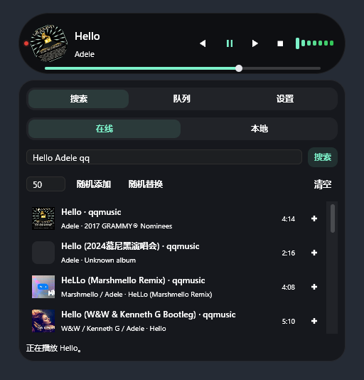
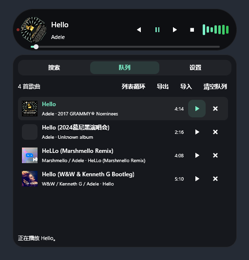
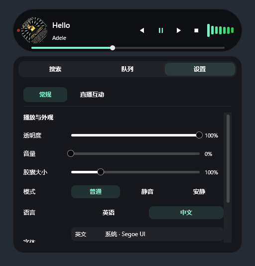
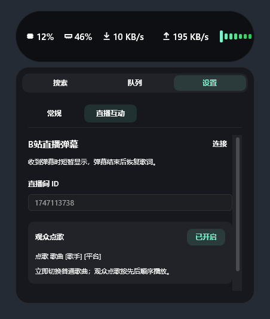

<p align="center">
  
</p>

<p align="center">
  <strong>A lightweight always-on-top desktop music island for search, import, playback, and system status.</strong>
</p>

<p align="center">
  <a href="README.md">中文</a>
</p>

<p align="center">
  
  
  
  
  
  
</p>

**CAPS** means **Catch All Possible Sources**, and also **capsule**. System stats while idle; lyrics, artwork, and spectrum while playing. Hover to expand.

<p align="center">
  <a href="https://github.com/ref42/CAPS/releases/latest"><strong>Download for Windows</strong></a> ·
  <a href="docs/music-playback.md">Music and search guide</a> ·
  <a href="docs/bilibili-live-danmu.md">Live chat guide</a>
</p>

## Search, queue, play

Search NetEase, QQ Music, KuGou, and Qishui together, or load local music. Online tracks play while downloading. Screenshots show the Chinese interface; English is available in Settings.

<table>
  <tr>
    <th>Search across platforms</th>
    <th>Playback queue</th>
  </tr>
  <tr>
    <td></td>
    <td></td>
  </tr>
</table>

- Search with `song [artist] [platform]`, such as `Hello Adele qq`. The preferred platform comes first; other results remain.
- Platforms: `netease` / `kugou` / `qq` / `qishui`, or their Chinese names. Artist and platform are optional.
- Select a search result to queue it; select a queued track to play. Choose in order, repeat all, repeat one, or shuffle.
- Export queues as JSON. Import appends new tracks and skips duplicates. Files contain song metadata, not audio.

## Make it yours, bring in your live chat

<table>
  <tr>
    <th>General settings</th>
    <th>Bilibili live chat</th>
  </tr>
  <tr>
    <td></td>
    <td></td>
  </tr>
</table>

Adjust size, opacity, and Latin/Chinese fonts. Connect a Bilibili room to show chat briefly in place of lyrics. Viewers can send `点歌 Hello Adele qq` to queue a song without interrupting playback; requests start automatically when idle.

## Get started

1. Download and run the Windows executable from [Releases](https://github.com/ref42/CAPS/releases/latest).
2. Hover to expand → search or load local music → add to the queue → select a track to play.
3. **Shift + left-drag** to reposition; move away to collapse; **right-click the capsule** to quit.

Track availability depends on the provider. Local queues need the original audio files. The guides above cover source limitations, chat emotes, and request rules.

<details>
<summary>Development and contributions</summary>

On Windows, install Rust and Visual Studio C++ Build Tools. CI uses nightly:

```powershell
cargo +nightly run --locked
cargo +nightly build --release --locked
```

[Issues](https://github.com/ref42/CAPS/issues) are welcome; please discuss larger changes first. Thanks to the maintainers of GPUI Kit, Rodio, CPAL, RustFFT, and all open-source dependencies.

</details>

[MIT License](LICENSE)
