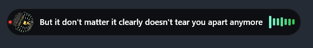
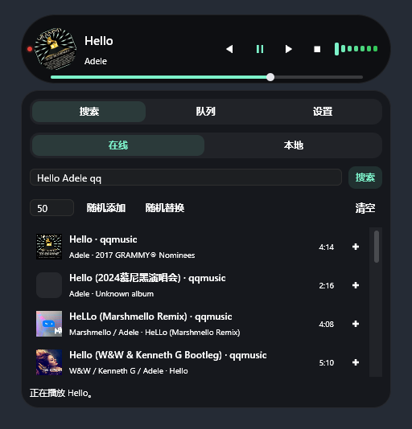
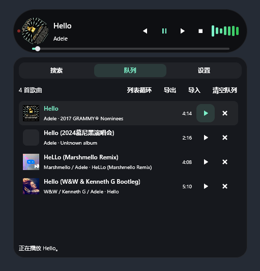
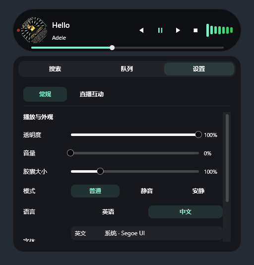
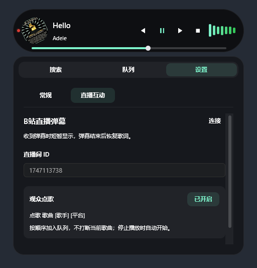

<p align="center">
  
</p>

<p align="center">
  <strong>一个常驻桌面顶部的轻量音乐岛：搜索、导入、播放和观察系统状态。</strong>
</p>

<p align="center">
  <a href="README.en.md">English</a>
</p>

<p align="center">
  
  
  
  
  
  
</p>

**CAPS** = **Catch All Possible Sources**，也是一颗桌面上的 capsule。空闲看系统状态，播放时看歌词、封面和频谱；鼠标悬停即可展开。

<p align="center">
  
</p>

<p align="center">
  <a href="https://github.com/ref42/CAPS/releases/latest"><strong>下载 Windows 版</strong></a> ·
  <a href="docs/music-playback.md">音乐与搜索说明</a> ·
  <a href="docs/bilibili-live-danmu.md">直播互动说明</a>
</p>

## 搜索，加入队列，开始播放

网易云、QQ 音乐、酷狗、汽水音乐一起搜，也可以加载本地音乐。在线歌曲支持边下载边播放。

<table>
  <tr>
    <th>跨平台搜索</th>
    <th>播放队列</th>
  </tr>
  <tr>
    <td></td>
    <td></td>
  </tr>
</table>

- 搜索格式：`歌曲 [歌手] [平台]`，例如 `晴天 周杰伦 qq`。指定平台优先，其他平台结果仍保留。
- 平台支持 `netease` / `kugou` / `qq` / `qishui` 及中文名；歌手、平台均可省略。
- 点击搜索结果加入队列，点击队列歌曲播放。支持顺序、列表循环、单曲循环和随机播放。
- 队列可导出为 JSON；导入只追加新歌曲、跳过重复项。文件保存歌曲信息，不包含音频。

## 调成喜欢的样子，也让直播间参与

<table>
  <tr>
    <th>常规设置</th>
    <th>B 站直播互动</th>
  </tr>
  <tr>
    <td></td>
    <td></td>
  </tr>
</table>

调整大小、透明度和中英文字体；连接 B 站直播间后，弹幕暂时代替歌词，结束后恢复。观众发送 `点歌 晴天 周杰伦 qq` 即可点歌，歌曲排队播放，不打断当前歌曲；空闲时自动开始。

## 上手只需几步

1. 从 [Releases](https://github.com/ref42/CAPS/releases/latest) 下载 Windows 可执行文件并运行。
2. 悬停展开 → 搜索或加载本地音乐 → 加入队列 → 点击播放。
3. **Shift + 左键拖动**调整位置；移开鼠标收起；**右键胶囊**退出。

歌曲可用性取决于平台；本地队列需要原音频文件。更多来源限制、弹幕表情和点歌规则见上方说明。

<details>
<summary>开发与贡献</summary>

Windows 环境需安装 Rust 和 Visual Studio C++ Build Tools。CI 使用 nightly：

```powershell
cargo +nightly run --locked
cargo +nightly build --release --locked
```

欢迎提交 [Issue](https://github.com/ref42/CAPS/issues)；较大的改动请先讨论。感谢 GPUI Kit、Rodio、CPAL、RustFFT 及所有开源依赖的维护者。

</details>

[MIT License](LICENSE)
